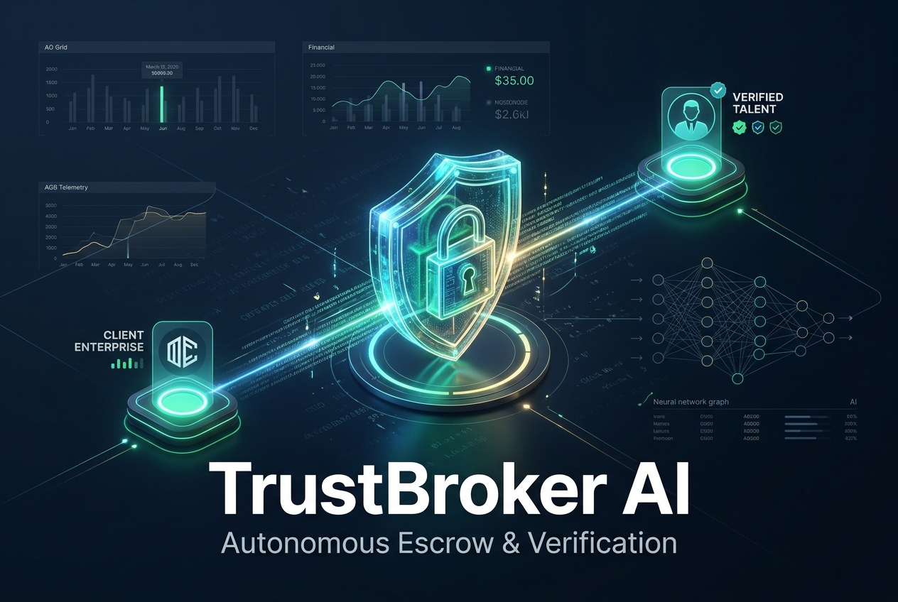
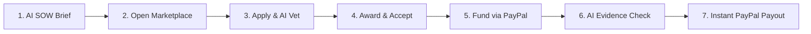
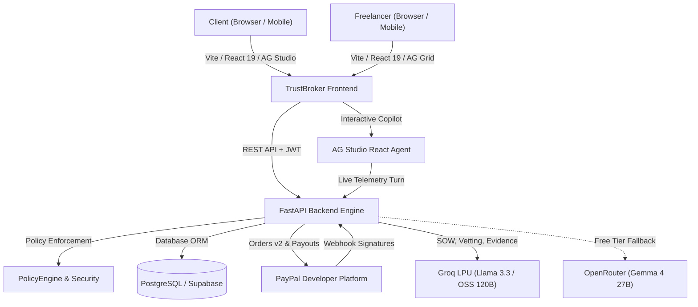

# TrustBroker AI

> **PayPal AI Hackathon 2026 Submission**  
> *The trust layer between clients and freelancers: Describe the work. Hire with evidence. Pay when the milestone checks out.*

[](https://trustbroker-ai-frontend-bx9a.onrender.com)
[](https://developer.paypal.com)
[](https://groq.com)
[](https://ag-grid.com)
[](https://fastapi.tiangolo.com)
[](https://react.dev)
[](LICENSE)

<p align="center">
  
</p>

---

## What is TrustBroker AI?

**TrustBroker AI** transforms freelance contracts from fragile promises into automated, policy-enforced milestone payment workflows. 

Clients describe milestones in plain English and AI drafts an objective Statement of Work (SOW) with verifiable acceptance criteria. Freelancers apply to open listings, where an AI vetting engine ranks candidates based on concrete portfolio evidence and skills—without penalizing talented newcomers who lack past platform contract history. 

Once awarded, clients stage milestone funds using **PayPal Checkout (Orders v2)**. When freelancers submit code, live URLs, or test suites, an automated AI evaluation engine verifies each criterion. Upon successful verification, the client authorizes a single-click disbursement executed directly via the **PayPal Payouts API** into the freelancer’s registered PayPal email.

> **Zero Mock Fallbacks on Payouts:** Every staged transaction generates authentic PayPal sandbox Order and Capture IDs and payouts execute through real PayPal Payout Batch APIs.  
> **Human Governance:** AI *never* unilaterally moves money. Funds release strictly according to an immutable **PolicyEngine** that validates cryptographic PayPal state, user authorization and milestone criteria verification.

---

## The 7-Step Contract & Payment Lifecycle



1. **Brief & SOW Generation:** Client inputs a project description; the AI generates structured milestones, timelines and measurable acceptance criteria.
2. **Publish Open Contract:** Contract is published to the public marketplace with visibility, category and skill tags.
3. **Apply & Impartial AI Vetting:** Freelancers submit proposals with portfolios; AI ranks candidates using skills and deliverable samples, giving newcomers a fair score (75%+) regardless of job history.
4. **Award & Mutual Acceptance:** Client awards the contract; cryptographic acceptances are recorded for both parties.
5. **Milestone Funding:** Client clicks the PayPal Smart Button to fund the active milestone via **PayPal Orders v2 Capture**. Funds are staged in the PayPal sandbox.
6. **Deliverable Submission & AI Verification:** Freelancer submits GitHub links, live URLs and test suites. Groq LPU multimodal AI scores deliverables against criteria with cited feedback.
7. **Instant PayPal Disbursement:** Client confirms release; the backend issues an idempotent payout call via **PayPal Payouts API** (`POST /v1/payments/payouts`), disbursing funds to the freelancer's PayPal email.

---

## Who It's For

- **For Clients:** Eliminate the fear of paying upfront for unfinished work. Rest assured milestone funds stay PayPal-secured until deliverables objectively pass AI verification.
- **For Freelancers:** Never worry about unpaid invoices or scope creep again. Know that milestone funds are already secured before writing code and receive instant payouts directly to your PayPal account upon verified delivery.

---

## System Architecture



---

## Tech Stack & Integrations

| Layer | Technology | Role & Purpose |
|---|---|---|
| **Payments** | **PayPal Orders v2 API** | Client milestone funding via PayPal Smart Buttons and server-side capture. |
| **Disbursements** | **PayPal Payouts API** | Automated, idempotent milestone releases to freelancer PayPal emails. |
| **Webhooks** | **PayPal Webhooks** | Server-side webhook handler for payment events (signature verification activates when `PAYPAL_WEBHOOK_ID` is set). |
| **Operations** | **AG Studio React & AG Grid** | Copilot agent with prompt starters, KPI telemetry and dense financial ledgers. |
| **AI Inference** | **Groq LPU (Primary)** | Sub-second SOW drafting, applicant ranking and multi-criterion evidence verification. |
| **AI Fallback** | **OpenRouter (Free Tier)** | Resilient free-tier fallback ensuring zero API downtime without cost. |
| **AI Fallback (Tier 3)** | **DeepSeek** | Optional paid fallback for maximum uptime when free tiers rate-limit. |
| **Backend** | **Python 3.12, FastAPI, SQLModel** | Async REST API, policy gatekeeper, audit trail and Alembic migrations. |
| **Frontend** | **React 19, TypeScript, Vite, Tailwind** | Dual-persona client & freelancer workspace, mobile-first responsive bottom navigation. |
| **Database & Auth** | **PostgreSQL & Supabase** | Relational schemas, row-level security and JWT session verification. |
| **Hosting** | **Render** | Production deployment of static frontend and auto-restarting FastAPI web service. |

---

## Devpost Tools Used

- **PayPal Platform:** Orders v2 API, Payments Capture API, Payouts API, Webhooks.
- **AG Studio & AG Grid:** `ag-studio-react`, `@ag-grid-community/react`, custom financial cell renderers.
- **Groq:** Fast LPU inference running open-weight LLMs (`openai/gpt-oss-120b`, `qwen/qwen3.8-27b`, `openai/gpt-oss-20b`).
- **OpenRouter:** Secondary free-tier fallback models (`google/gemma-4-27b-it:free`).
- **DeepSeek:** Optional paid tier-3 fallback (`deepseek-chat`) for maximum uptime.
- **Render:** Cloud hosting for static SPA and containerized Python API.
- **Postman & APIMatic:** API collection testing and contract generation — see [`postman/TrustBroker_AI.postman_collection.json`](postman/TrustBroker_AI.postman_collection.json).

*(Note: Core inference runs on $0-budget tiers (Groq + OpenRouter free). DeepSeek is an optional paid tier-3 fallback. This project does not use Gemini, KERNEL, or Bryntum.)*

---

## Repository Structure

```
trustbroker_ai/
├── backend/                         # FastAPI Python Service
│   ├── alembic/                     # Database migrations (idempotent PostgreSQL)
│   ├── app/
│   │   ├── models/                  # SQLModel schemas (contracts, milestones, payouts)
│   │   ├── routers/                 # REST endpoints (contracts, payments, ai, studio)
│   │   ├── services/                # PolicyEngine, PayPal client, Groq AI verification
│   │   ├── seed.py                  # Demo accounts, open listings, mid-flight contracts
│   │   └── start.py                 # Self-healing production entrypoint
│   └── tests/                       # Automated test suites (PayPal and AI verification)
├── react_app/                       # React 19 + TypeScript Frontend
│   ├── src/
│   │   ├── components/layout/       # Sidebar, BottomNav, DashboardLayout, Bell Popover
│   │   ├── hooks/                   # State stores (contracts, auth, notifications)
│   │   ├── lib/                     # Typed API client with PayPal and AG Studio adapters
│   │   └── pages/
│   │       ├── client/              # Client Dashboard & AG Studio Operations
│   │       ├── freelancer/          # Marketplace, Applications, AG Studio Operations
│   │       ├── ContractDetail.tsx   # Milestone lifecycle timeline & PayPal buttons
│   │       ├── DeliveryVerification # Evidence submission & AI evaluation matrix
│   │       └── Notifications.tsx    # Filterable in-app notification center
├── demo_assets/                     # Verification test files
│   ├── pass_evidence.txt            # Compliant test suite logs & sub-second performance
│   ├── fail_evidence.txt            # Deficient bundle size & missing webhook signatures
│   └── pass_evidence.json           # Structured JSON milestone deliverables
├── docs/
│   ├── JUDGE_DEMO.md                # 10-minute step-by-step judge testing guide
│   └── TrustBroker_AI_Hackathon_Roadmap.md # Phase execution plan
├── md_artifacts/
│   └── TrustBroker_AI_Project_Guide.md     # Full design specification
└── postman/
    └── TrustBroker_AI.postman_collection.json # 30-request end-to-end API collection
```

---

## Quick Start & Local Run

### Prerequisites
- Node.js 18+ & npm
- Python 3.12+
- PostgreSQL database (or local Supabase instance)

### 1. Backend Setup

```bash
cd backend
python -m venv .venv

# On Windows:
.venv\Scripts\activate
# On macOS/Linux:
source .venv/bin/activate

pip install -r requirements.txt
cp .env.example .env

# Run database migrations and seed showcase data
python -m app.seed

# Start FastAPI server
uvicorn app.main:app --host 0.0.0.0 --port 8000 --reload
```

### 2. Frontend Setup

```bash
cd react_app
npm install
cp .env.example .env
npm run dev
```

Visit `http://localhost:5173` to explore the application locally.

---

## Judge Walkthrough & Demo Credentials

To test the complete end-to-end flow with real PayPal sandbox money movement:

1. Follow the 10-minute click-by-click instructions in [**`docs/JUDGE_DEMO.md`**](docs/JUDGE_DEMO.md).
2. Use the pre-seeded demo personas:
   - **Client:** `client.demo@trustbroker.ai` / `DemoPassword2026!`
   - **Freelancer:** `freelancer.demo@trustbroker.ai` / `DemoPassword2026!`
   - **Newcomer:** `newcomer.demo@trustbroker.ai` / `DemoPassword2026!`
3. Test deliverable verification using files in [`demo_assets/pass_evidence.txt`](demo_assets/pass_evidence.txt) and [`demo_assets/fail_evidence.txt`](demo_assets/fail_evidence.txt).

---

## License

This project is licensed under the MIT License — see the [LICENSE](LICENSE) file for details.
