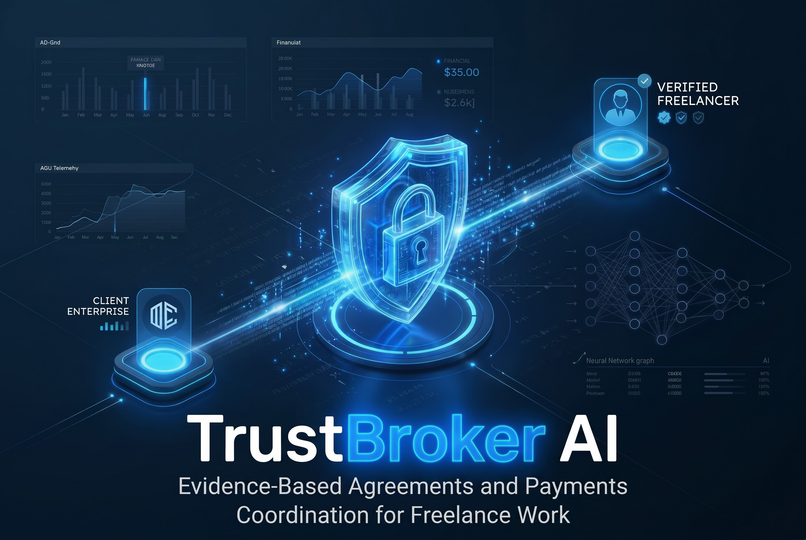
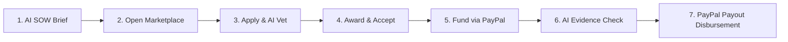
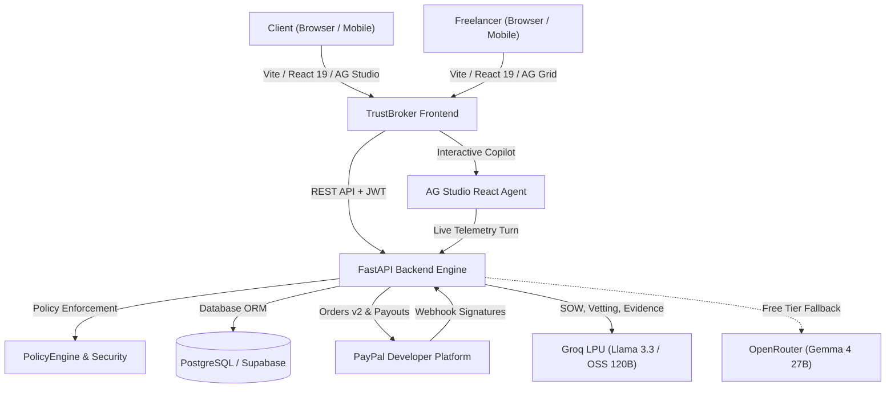

# TrustBroker AI

> **PayPal AI Hackathon 2026 Submission**  
> *The trust layer between clients and freelancers: Describe the work. Hire with evidence. Pay when the milestone checks out.*

[](https://trustbroker-ai-frontend-bx9a.onrender.com)
[](https://developer.paypal.com)
[](https://groq.com)
[](https://ag-grid.com)
[](https://fastapi.tiangolo.com)
[](https://react.dev)
[](LICENSE)

<p align="center">
  
</p>

---

## What is TrustBroker AI?

**TrustBroker AI** transforms freelance contracts from fragile promises into automated, policy-enforced milestone payment workflows. 

Clients describe milestones in plain English and AI drafts an objective Statement of Work (SOW) with verifiable acceptance criteria. Freelancers apply to open listings, where an AI vetting engine ranks candidates based on concrete portfolio evidence and skills—without penalizing talented newcomers who lack past platform contract history. 

Once awarded, clients stage milestone funds using **PayPal Checkout (Orders v2)**. When freelancers submit code, live URLs, or test suites, an automated AI evaluation engine verifies each criterion. Upon successful verification, the client authorizes a single-click disbursement executed directly via the **PayPal Payouts API** into the freelancer’s registered PayPal email.

> **Provider Truthfulness on Payments:** Every staged transaction communicates with authentic PayPal sandbox Orders and Payouts APIs with strict error propagation and no synthetic IDs.  
> **Human Governance:** AI *never* unilaterally moves money. Funds release strictly requires explicit authenticated client authorization via the **PolicyEngine** after multimodal criteria verification.

---

## The 7-Step Contract & Payment Lifecycle



1. **Brief & SOW Generation:** Client inputs a project description; the AI generates structured milestones, timelines and measurable acceptance criteria.
2. **Publish Open Contract:** Contract is published to the public marketplace with visibility, category and skill tags.
3. **Apply & Impartial AI Vetting:** Freelancers submit proposals with portfolios; AI ranks candidates using skills and deliverable samples, giving newcomers a fair score (75%+) regardless of job history.
4. **Award & Mutual Acceptance:** Client awards the contract; cryptographic acceptances are recorded for both parties.
5. **Milestone Funding:** Client clicks the PayPal Smart Button to fund the active milestone via **PayPal Orders v2 Capture**. Funds are staged in the PayPal sandbox.
6. **Deliverable Submission & AI Verification:** Freelancer submits GitHub links, live URLs and test suites. Groq LPU multimodal AI scores deliverables against criteria with cited feedback.
7. **PayPal Payout Disbursement & Ledger Tracking:** Client confirms release; the backend issues an idempotent payout call via **PayPal Payouts API** (`POST /v1/payments/payouts`), submitting funds to the freelancer's PayPal email with real-time toast feedback, status transitions ('Payout Submitted' until PayPal webhook confirms item success), and full tracking in the Client Payout Management ledger.

---

## Who It's For

- **For Clients:** Eliminate the fear of paying upfront for unfinished work. Rest assured milestone funds stay PayPal-secured until deliverables objectively pass AI verification.
- **For Freelancers:** Never worry about unpaid invoices or scope creep again. Know that milestone funds are already secured before writing code and receive instant payouts directly to your PayPal account upon verified delivery.

---

## System Architecture



---

## Tech Stack & Integrations

| Layer | Technology | Role & Purpose |
|---|---|---|
| **Payments** | **PayPal Orders v2 API** | Client milestone funding via PayPal Smart Buttons and server-side capture. |
| **Disbursements** | **PayPal Payouts API** | Automated, idempotent milestone releases to freelancer PayPal emails. |
| **Webhooks** | **PayPal Webhooks** | Server-side webhook handler for payment events (signature verification activates when `PAYPAL_WEBHOOK_ID` is set). |
| **Operations** | **AG Studio React & AG Grid** | Copilot agent with prompt starters, KPI telemetry and dense financial ledgers. |
| **AI Inference** | **Groq LPU (Primary)** | Sub-second SOW drafting, applicant ranking and multi-criterion evidence verification. |
| **AI Fallback** | **OpenRouter (Free Tier)** | Resilient free-tier fallback ensuring zero API downtime without cost. |
| **AI Fallback (Tier 3)** | **DeepSeek** | Optional paid fallback for maximum uptime when free tiers rate-limit. |
| **Backend** | **Python 3.12, FastAPI, SQLModel** | Async REST API, policy gatekeeper, audit trail and Alembic migrations. |
| **Frontend** | **React 19, TypeScript, Vite, Tailwind** | Dual-persona client & freelancer workspace, mobile-first responsive bottom navigation. |
| **Database & Auth** | **PostgreSQL & Supabase** | Relational schemas, row-level security and JWT session verification. |
| **Hosting** | **Render** | Production deployment of static frontend and auto-restarting FastAPI web service. |

---

## Devpost Tools Used

- **PayPal Platform:** Orders v2 API, Payments Capture API, Payouts API, Webhooks.
- **AG Studio & AG Grid:** `ag-studio-react`, `@ag-grid-community/react`, custom financial cell renderers.
- **Groq:** Fast LPU inference running open-weight LLMs (`openai/gpt-oss-120b`, `qwen/qwen3.8-27b`, `openai/gpt-oss-20b`).
- **OpenRouter:** Secondary free-tier fallback models (`google/gemma-4-27b-it:free`).
- **DeepSeek:** Optional paid tier-3 fallback (`deepseek-chat`) for maximum uptime.
- **Render:** Cloud hosting for static SPA and containerized Python API.
- **Postman & APIMatic:** API collection testing and contract generation — see [`postman/TrustBroker_AI.postman_collection.json`](postman/TrustBroker_AI.postman_collection.json).

*(Note: Core inference runs on $0-budget tiers (Groq + OpenRouter free). DeepSeek is an optional paid tier-3 fallback. This project does not use Gemini, KERNEL, or Bryntum.)*

---

## Repository Structure

```
trustbroker_ai/
├── backend/                         # FastAPI Python Service
│   ├── alembic/                     # Database migrations (idempotent PostgreSQL)
│   ├── app/
│   │   ├── models/                  # SQLModel schemas (contracts, milestones, payouts)
│   │   ├── routers/                 # REST endpoints (contracts, payments, ai, studio)
│   │   ├── services/                # PolicyEngine, PayPal client, Groq AI verification
│   │   ├── seed.py                  # Demo accounts, open listings, mid-flight contracts
│   │   └── start.py                 # Self-healing production entrypoint
│   └── tests/                       # Automated test suites (PayPal and AI verification)
├── react_app/                       # React 19 + TypeScript Frontend
│   ├── src/
│   │   ├── components/layout/       # Sidebar, BottomNav, DashboardLayout, Bell Popover
│   │   ├── hooks/                   # State stores (contracts, auth, notifications)
│   │   ├── lib/                     # Typed API client with PayPal and AG Studio adapters
│   │   └── pages/
│   │       ├── client/              # Client Dashboard, Contracts, Applications, Payouts, AG Studio
│   │       ├── freelancer/          # Marketplace, Applications, Active Work, Earnings, AG Studio
│   │       ├── ContractDetail.tsx   # SOW lifecycle timeline, cryptographic hashes, PayPal buttons & CRUD
│   │       ├── DeliveryVerification # 3-column evidence inspection, multimodal AI evaluation, & settlement
│   │       ├── ActivityHistory.tsx  # Immutable audit trail ledger
│   │       └── Notifications.tsx    # Filterable notification center with single/bulk deletion
├── demo_assets/                     # Verification test files
│   ├── pass_evidence.txt            # Compliant test suite logs & sub-second performance
│   ├── fail_evidence.txt            # Deficient bundle size & missing webhook signatures
│   └── pass_evidence.json           # Structured JSON milestone deliverables
├── docs/
│   ├── JUDGE_DEMO.md                # 10-minute step-by-step judge testing guide
│   └── TrustBroker_AI_Hackathon_Roadmap.md # Phase execution plan
├── md_artifacts/
│   └── TrustBroker_AI_Project_Guide.md     # Full design specification
└── postman/
    └── TrustBroker_AI.postman_collection.json # 30-request end-to-end API collection
```

---

## Quick Start & Local Run

### Prerequisites
- Node.js 20+ & npm
- Python 3.12+
- PostgreSQL database (or local Supabase instance)

### 1. Backend Setup

```bash
cd backend
python -m venv .venv

# On Windows:
.venv\Scripts\activate
# On macOS/Linux:
source .venv/bin/activate

pip install -r requirements.txt
cp .env.example .env

# Run database migrations and seed showcase data
python -m app.seed

# Start FastAPI server
uvicorn app.main:app --host 0.0.0.0 --port 8000 --reload
```

### 2. Frontend Setup

```bash
cd react_app
npm install
cp .env.example .env
npm run dev
```

Visit `http://localhost:5173` to explore the application locally.

---

## Deliverable Storage & Supabase Free-Tier Setup

TrustBroker AI features dual-tier storage for deliverable evidence (screenshots, zip archives, PDFs, design files):

- **Supabase Storage (Production / Cloud):** When configured, files upload directly to a private Supabase Storage bucket (`delivery-evidence`). Access is secured via short-lived signed URLs.
- **Local Disk Fallback (Zero-Downtime Resilience):** If Supabase storage credentials are not provided or the bucket is not yet initialized, files automatically save to private backend storage at `uploads/evidence/`.
- **Free Tier Capacity & Limits:**
  - Supabase's free tier provides **1 GB total storage** with a **50 MB per-file upload limit**.
  - TrustBroker AI enforces a safe **25 MB per-file validation limit** in both frontend and backend, ensuring uploads never exceed Supabase free-tier thresholds.

### How to Configure Supabase Storage (5-Minute Setup)

1. Log into your [Supabase Dashboard](https://supabase.com/dashboard) and open your project.
2. Navigate to **Storage** in the left sidebar menu (the bucket icon).
3. Click **New bucket**:
   - **Name:** `delivery-evidence`
   - **Public bucket:** Keep **OFF / Disabled** (ensures deliverables remain confidential between contract parties).
   - **File size limit:** Set to `50MB` (or leave default).
   - Click **Save**.
4. Set backend environment variables in `.env` or Render environment settings:
   ```env
   SUPABASE_URL=https://[YOUR-PROJECT-ID].supabase.co
   SUPABASE_SERVICE_ROLE_KEY=[YOUR-SERVICE-ROLE-KEY]
   ```
5. Deliverables submitted by freelancers will now securely persist in your Supabase bucket.

---

## Judge Walkthrough & Demo Credentials

To test the complete end-to-end flow with real PayPal sandbox money movement:

1. Follow the 10-minute click-by-click instructions in [**`docs/JUDGE_DEMO.md`**](docs/JUDGE_DEMO.md).
2. Use the pre-seeded demo personas:
   - **Client:** `client.demo@trustbroker.ai` / `DemoPassword2026!`
   - **Freelancer:** `freelancer.demo@trustbroker.ai` / `DemoPassword2026!`
   - **Newcomer:** `newcomer.demo@trustbroker.ai` / `DemoPassword2026!`
3. Test deliverable verification using files in [`demo_assets/pass_evidence.txt`](demo_assets/pass_evidence.txt) and [`demo_assets/fail_evidence.txt`](demo_assets/fail_evidence.txt).

---

## Recent Engineering Updates (November 2026)

- **Production Hardening & Hackathon Remediation (Phases 1–9 Complete):**
  - **Verification Truthfulness (Phase 1):** Removed all heuristic pass fallbacks from vision, repo metadata, and document adapters. When external APIs fail, rate limit, or time out, adapters safely return `NEEDS_REVIEW` (score 50, requires human review) instead of false passes. Orchestrator calls real AI evaluator with structured JSON schema enforcement; model attribution records real model or `fallback:none`.
  - **CORS Exception Reflection Hardening (Phase 2):** Eliminated arbitrary origin reflection from the global exception handler. Generic error responses in production mask internal stack traces, SQL, and system paths.
  - **Startup Migration Hardening (Phase 3):** Removed automatic `stamp head` on generic Alembic CLI exit code errors, preventing the server from serving traffic against unmigrated or corrupted database schemas.
  - **PayPal Capture Validation & Integrity (Phase 4):** Required amount and currency validation with exact `Decimal` precision matching against stored attempts. Disallowed multiple purchase units; unapproved checkouts return `cancelled` rather than `refunded`.
  - **Evidence Upload Ownership & Scoped Paths (Phase 5):** Added server-owned path scoping `validate_storage_path()` (`supabase://delivery-evidence/{uploader_id}/...` or `uploads/evidence/{uploader_id}/...`), preventing cross-user file hijacking and directory traversal (`os.path.realpath`). Enforces durable Supabase cloud storage in production.
  - **Truthful Payout Lifecycle & UI Accuracy (Phase 6):** Added `RECONCILIATION_REQUIRED` state for ambiguous network timeouts. Disbursal responses accurately reflect requested vs released amounts. Freelancer notifications and UI badges distinctly handle `Submitted`, `Release Authorized`, `Returned`, and `Reconciliation Required`.
  - **Verification Job Terminal State (Phase 7):** Age-based detection flags background verification jobs running > 90s without reports as `interrupted` (service restart) or `needs_review` (> 45s without report), preventing jobs from hanging forever. Frontend polling breaks cleanly on terminal states.
  - **Demo Seeding Safety (Phase 8):** Seed script safely refreshes showcase demo personas without resetting auth credentials or overwriting financial records. Seeded notifications use truthful phrasing ("submitted to PayPal").
  - **Documentation & Demo Walkthrough Accuracy (Phase 9):** Aligned `JUDGE_DEMO.md` and `DEVPOST_SUBMISSION.md` with real system capabilities and documented known sandbox limitations.
  - **Automated Backend CI Testing:** Expanded automated test suite from 55 to **79 passing tests** (100% pass rate) with robust mock isolation, covering security, payments, SSRF, adapters, and vetting.
- **Comprehensive Security, Payment & Evidence Remediation (Phase 16):** Fully executed the 14-workstream remediation plan across authentication, payment state machines, AI verification truthfulness, and external security:
  - **Zero Synthetic Fallbacks & Provider Truthfulness:** Eliminated all fabricated PayPal capture IDs (`SANDBOX-CAP-*`), batch IDs (`SANDBOX-BATCH-*`), and invented payout emails. Payment operations strictly report authentic PayPal Orders v2 and Payouts API responses. Captures gracefully reconcile real order states (`422 / ORDER_ALREADY_CAPTURED`).
  - **Deterministic PolicyEngine Lifecycle:** AI verification passing updates work status to `VERIFIED` but never mutates payment status to `RELEASE_AUTHORIZED`. Contracts cannot reach `COMPLETED` until all milestones are fully settled financially via provider-confirmed payouts.
  - **SSRF & Network Boundary Protection:** Reinforced `validate_url_for_ssrf()` blocking loopbacks (`127.0.0.1`, `localhost`), link-local/cloud metadata (`169.254.169.254`), private RFC1918 subnets, non-standard ports, and embedded credentials before any HTTP probe executes.
  - **Real Server Storage Evidence Uploads:** Eliminated browser-local `blob:` URLs in delivery submissions. Deliverables upload directly through `POST /api/v1/deliveries/upload-file` to private storage, backed by Supabase Storage or server disk fallback.
  - **AI Verification Truthfulness:** Removed deterministic pass fallbacks. When AI models are unavailable or unconfigured, the verification engine returns `NEEDS_REVIEW` (score 50, `requires_human_review: True`), safely pausing disbursement until manual review.
  - **Production Seeding & Startup Safety:** Alembic migrations no longer blindly stamp `head` on failures. Database demo seeding is strictly guarded behind `SEED_DEMO_DATA=true` to prevent overwriting real user profiles in production.
  - **CORS Hardening:** Restricted allowed origins regex strictly to `^https:\/\/trustbroker-ai-frontend-[a-z0-9]+\.onrender\.com$`.
- **Role-Aware Canonical Routing & Complete Route Audit (Phase 15):** Completed an exhaustive audit of all routing and navigation across client and freelancer portals. Replaced all legacy `/dashboard/...` targets with canonical `/app/client/...` and `/app/freelancer/...` endpoints. Configured backwards-compatible `<Navigate replace />` redirects in `routes.tsx` for all historical dashboard paths, added canonical constants (`ROUTES.NOTIFICATIONS`, `ROUTES.CLIENT_PROFILE_PUBLIC`, `ROUTES.ACTIVITY_HISTORY`), and updated the breadcrumb system to be role-aware (`Dashboard` for clients, `Home` for freelancers).
- **Delivery Review Ergonomics & Balanced 3-Column Layout:** Overhauled the delivery verification view into a balanced 3-column architecture (`4 / 4 / 4` column grid on a spacious `max-w-7xl` container):
  - **Column 1 (Freelancer Delivery Package):** Read-only client view displaying live preview links, source code repositories, delivery notes, and classified evidence attachments.
  - **Column 2 (AI Verification Assessment):** Automated multimodal inspection report showing per-criterion pass/fail badges, explanations, and overall AI score, with an informational status card guiding clients to Column 3.
  - **Column 3 (Client Manual Review & Settlement):** Dedicated client action panel with primary `Authorize PayPal Payout ($X)` disbursement, plus fintech-tinted secondary action buttons (`Request Revision`, `AI Dispute Mediation`, and `Reclaim Escrow`) with ample spacing and bottom clearance above the floating AI copilot FAB.
- **Backend Delivery Package & Verification Report Aggregation:** Enhanced `DeliveryRead` and `delivery_service.py` to automatically embed full verification reports and individual `CriterionResult` details (`criterion_id`, `score`, `passed`, `explanation`) in milestone delivery queries.
- **Client-Only Payout Disbursal Role Isolation:** Strictly isolated payment release authorization to verified contract clients in both the backend `PolicyEngine` (`require_client()`) and frontend components. Freelancers receive a dedicated "Awaiting Client Release" status banner with a 1-click disbursal reminder action.
- **Guarded CRUD Operations & Record Immutability:** Implemented fine-grained, secure CRUD operations across contracts, milestones, acceptance criteria, applications, notifications, and profiles. Draft contracts can be deleted with full cascade cleanup of uncommitted milestones and criteria; pending applications can be withdrawn; read notifications can be batch-cleared. Crucially, all active and completed contracts, payment attempts, payouts, audit events, deliveries, and legal signatures remain permanently immutable to guarantee financial and legal non-repudiation.
- **Milestone Staging Safeguards & Buyer/Seller Protection:** Integrated buyer protection reset for inactivity or unaddressed revisions, automatic clock pausing upon revision requests, and multimodal AI dispute mediation for transparent conflict resolution.
- **Web Development Category:** Added **Web Development** to contract creation category dropdowns and one-click filter chips.
- **Studio AI Copilot Ergonomics:** Upgraded the floating operations copilot with expanded vertical height (`700px` / `82vh`), unconstrained flex scrolling, and high-contrast typography for effortless reading of telemetry analyses and suggested queries.
- **Client Payout Management & Ledger:** Dedicated portal at `/app/client/payouts` displaying aggregate balances, disbursed totals, active in-flight payouts, and interactive order/batch logs.
- **Automated Startup Schema Migrations:** Integrated auto-reconciliation in the FastAPI lifespan to automatically detect and apply missing PostgreSQL columns (`content_hash`, `ip_address`, `user_agent`) in Supabase.
- **Resilient AI Verification Engine:** Multimodal scoring treats CDN edge rate-limiting (HTTP 429/403) from Vercel, Cloudflare, and GitHub as `NEEDS_REVIEW` instead of false-positive hard failures. Image-based diagrams submitted as documents are routed to the vision adapter.
- **Robust Sandbox Payment Staging:** Expanded PayPal error mapping recovers cleanly from sandbox edge cases (`422`, `ORDER_ALREADY_CAPTURED`, `INSTRUMENT_DECLINED`) to ensure testing workflows complete.

---

## License

This project is licensed under the MIT License — see the [LICENSE](LICENSE) file for details.
