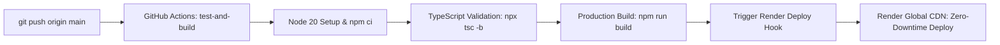

# TrustBroker AI — Free Frontend Hosting on Render & GitHub CI/CD

This guide explains how to host the **TrustBroker AI Frontend** on **Render for free** ($0/month forever) and how the automated **GitHub Actions CI/CD pipeline** deploys updates on every push to `main`.

---

## 1. Quick Overview

- **Hosting Platform:** [Render](https://render.com) (Static Site Tier — 100% Free Forever)
- **Bandwidth:** 100 GB/month included free
- **SSL / HTTPS:** Automatic free managed TLS certificates
- **Global CDN:** Fast asset delivery across worldwide edge nodes
- **Client-Side Routing:** Configured with SPA rewrite rule (`/* -> /index.html`) so deep dashboard URLs (e.g. `/dashboard/contracts/contract-1`) never return 404 errors on refresh.
- **CI/CD Automation:** GitHub Actions runs automated type checking (`tsc -b`), production bundling (`npm run build`), and triggers a zero-downtime deploy via Render's Deploy Hook.

---

## 2. Option A: 1-Click Setup via Render Blueprint (Recommended)

Because we have added [`render.yaml`](./render.yaml) to the repository root, Render can configure everything automatically:

1. Sign up or log in at [dashboard.render.com](https://dashboard.render.com).
2. Click **New +** in the top navigation and select **Blueprint**.
3. Select your GitHub repository (`brianproducedit/trustbroker_ai`).
4. Render will automatically detect `render.yaml` and display the blueprint configuration:
   - **Service Name:** `trustbroker-ai-frontend`
   - **Runtime:** `Static Site` (Free)
   - **Root Directory:** `react_app`
   - **Build Command:** `npm ci && npm run build`
   - **Publish Directory:** `./dist`
   - **SPA Rewrite Rule:** `/*` $\rightarrow$ `/index.html`
5. Click **Apply**. Render will trigger the first build and deploy your live URL (e.g. `https://trustbroker-ai-frontend.onrender.com`).

---

## 3. Option B: Manual Static Site Setup

If you prefer to configure the service manually in the Render UI:

1. In the Render Dashboard, click **New +** $\rightarrow$ **Static Site**.
2. Connect your GitHub repository: `brianproducedit/trustbroker_ai`.
3. Fill in the service settings:
   - **Name:** `trustbroker-ai-frontend`
   - **Branch:** `main`
   - **Root Directory:** `react_app`
   - **Build Command:** `npm ci && npm run build`
   - **Publish Directory:** `dist`
4. Add the SPA Rewrite Rule (Required for React Router):
   - Go to **Redirects/Rewrites** tab.
   - Click **Add Rule**:
     - **Type:** `Rewrite`
     - **Source:** `/*`
     - **Destination:** `/index.html`
5. Click **Create Static Site**.

---

## 4. Connecting the GitHub Actions CI/CD Pipeline

The repository includes a ready-to-run GitHub Actions workflow at [`.github/workflows/ci.yml`](./.github/workflows/ci.yml).

To enable instant webhook deploys directly from GitHub Actions:

### Step 1: Generate a Deploy Hook on Render
1. Open your `trustbroker-ai-frontend` service in the [Render Dashboard](https://dashboard.render.com).
2. Navigate to **Settings** $\rightarrow$ **Deploy Hook**.
3. Click **Create Deploy Hook** (or copy the existing URL).
   - It will look like: `https://api.render.com/deploy/srv-xxxxxx?key=yyyyyy`

### Step 2: Add the Secret to GitHub
1. In your GitHub repository (`brianproducedit/trustbroker_ai`), go to **Settings** $\rightarrow$ **Secrets and variables** $\rightarrow$ **Actions**.
2. Click **New repository secret**.
3. Set:
   - **Name:** `RENDER_DEPLOY_HOOK_URL`
   - **Secret:** *(Paste your Render Deploy Hook URL)*
4. Click **Add secret**.

---

## 5. How the Automated CI/CD Pipeline Works

Whenever you push to the `main` branch or merge a pull request:



1. **`test-and-build` Job:**
   - Installs clean dependencies using `npm ci`.
   - Validates all TypeScript types with `tsc -b`.
   - Builds the production bundle (`dist/`).
   - Saves the build artifact in GitHub Actions.
2. **`deploy-render` Job:**
   - Triggers the Render Deploy Hook.
   - If the secret is set, Render immediately deploys the verified bundle.
   - If the secret is not yet set, the workflow logs a helpful notice without breaking the build, and Render's native GitHub integration deploys automatically.

---

## 6. Local Production Build Test

You can test the exact production build locally before committing:

```bash
cd react_app
npm run build
npm run preview
```

The site will be served locally at `http://localhost:4173` replicating the exact Render static environment.
