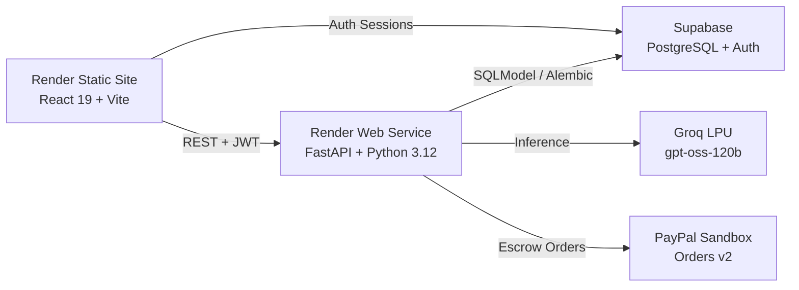

# TrustBroker AI — Full-Stack Deployment Guide (Render, Supabase & PayPal)

This guide covers complete deployment of **TrustBroker AI** on **Render for free** ($0/month):
- **Frontend:** React 19 + TypeScript + Vite as a Render Static Site
- **Backend:** FastAPI + SQLModel + Alembic as a Render Web Service
- **Database & Auth:** Supabase PostgreSQL & Supabase Auth
- **AI Engine:** Groq LPU (`openai/gpt-oss-120b`) + OpenRouter fallback
- **Payments:** PayPal Orders v2 Sandbox with server-side capture

---

## 1. Quick Architecture Overview

---

## 2. Option A: 1-Click Blueprint Deploy (Recommended)

The repository root includes a complete [`render.yaml`](../render.yaml) Blueprint that sets up both the frontend static site and backend API in one step:

1. Sign in to your [Render Dashboard](https://dashboard.render.com).
2. Click **New +** $\rightarrow$ **Blueprint**.
3. Select this repository: `brianproducedit/trustbroker_ai`.
4. Render detects `render.yaml` and provisions:
   - **`trustbroker-ai-frontend`** (Static Site, Root: `react_app`, Build: `npm ci && npm run build`, Publish: `./dist`)
   - **`trustbroker-ai-api`** (Web Service, Root: `backend`, Build: `pip install -r requirements.txt`, Start: `alembic upgrade head && uvicorn app.main:app --host 0.0.0.0 --port $PORT`)
5. Fill in the required environment variables prompted by Render (see Section 4 below).
6. Click **Apply**. Render will run migrations, deploy the API, and compile the frontend.

---

## 3. Option B: Manual Service Configuration

### Step 1: Deploy Backend Web Service
1. In Render Dashboard, click **New +** $\rightarrow$ **Web Service**.
2. Connect your repo and configure:
   - **Name:** `trustbroker-ai-api`
   - **Region:** `Oregon (US West)`
   - **Branch:** `main`
   - **Root Directory:** `backend`
   - **Runtime:** `Python 3`
   - **Build Command:** `pip install -r requirements.txt`
   - **Start Command:** `alembic upgrade head && uvicorn app.main:app --host 0.0.0.0 --port $PORT`
   - **Instance Type:** `Free`
3. Add the Backend Environment Variables (Section 4).
4. Click **Create Web Service**. Note the deployed URL (e.g. `https://trustbroker-ai-api.onrender.com`).

### Step 2: Deploy Frontend Static Site
1. In Render Dashboard, click **New +** $\rightarrow$ **Static Site**.
2. Connect your repo and configure:
   - **Name:** `trustbroker-ai-frontend`
   - **Branch:** `main`
   - **Root Directory:** `react_app`
   - **Build Command:** `npm ci && npm run build`
   - **Publish Directory:** `dist`
3. Add the Frontend Environment Variables (Section 4).
4. Configure SPA Rewrite Rule (Under **Redirects/Rewrites** tab):
   - **Type:** `Rewrite`
   - **Source:** `/*`
   - **Destination:** `/index.html`
5. Click **Create Static Site**. Note the deployed URL (e.g. `https://trustbroker-ai-frontend.onrender.com`).

---

## 4. Required Environment Variables

### Backend (`trustbroker-ai-api`)
| Variable | Value / Source | Description |
|---|---|---|
| `ENVIRONMENT` | `production` | App environment mode |
| `DATABASE_URL` | Supabase $\rightarrow$ Settings $\rightarrow$ Database $\rightarrow$ URI | Direct PostgreSQL connection string |
| `SUPABASE_URL` | `https://fgdvlrfbpzkaetwwjhxq.supabase.co` | Supabase project API URL |
| `SUPABASE_SERVICE_ROLE_KEY` | Supabase $\rightarrow$ Settings $\rightarrow$ API $\rightarrow$ `service_role` | Secret backend admin key |
| `SUPABASE_JWT_SECRET` | Supabase $\rightarrow$ Settings $\rightarrow$ API $\rightarrow$ JWT Secret | Shared secret for HS256 JWT decoding |
| `PAYPAL_CLIENT_ID` | PayPal Developer Portal $\rightarrow$ Apps & Credentials | Sandbox REST App Client ID |
| `PAYPAL_CLIENT_SECRET` | PayPal Developer Portal $\rightarrow$ Apps & Credentials | Sandbox REST App Secret |
| `PAYPAL_MODE` | `sandbox` | `sandbox` for testing, `live` for production |
| `PAYPAL_WEBHOOK_ID` | PayPal Developer $\rightarrow$ Webhooks | Webhook ID for signature verification |
| `GROQ_API_KEY` | [console.groq.com](https://console.groq.com) | Groq LPU API key |
| `GROQ_MODEL` | `openai/gpt-oss-120b` | High-speed primary SOW & evaluation model |
| `OPENROUTER_API_KEY` | [openrouter.ai](https://openrouter.ai) | Secondary fallback API key |
| `OPENROUTER_MODEL` | `google/gemma-4-27b-it:free` | Free fallback model |
| `FRONTEND_URL` | `https://trustbroker-ai-frontend.onrender.com` | Deployed frontend origin |
| `ALLOWED_ORIGINS` | `https://trustbroker-ai-frontend.onrender.com,http://localhost:5173` | Allowed CORS origins |

### Frontend (`trustbroker-ai-frontend`)
| Variable | Value / Source |
|---|---|
| `VITE_API_BASE_URL` | `https://trustbroker-ai-api.onrender.com/api/v1` |
| `VITE_SUPABASE_URL` | `https://fgdvlrfbpzkaetwwjhxq.supabase.co` |
| `VITE_SUPABASE_ANON_KEY` | Supabase $\rightarrow$ Settings $\rightarrow$ API $\rightarrow$ `anon` public key |
| `VITE_PAYPAL_CLIENT_ID` | PayPal Sandbox Client ID |

---

## 5. Supabase Auth & Email Settings

1. **Disable Email Confirmations for Demo:**
   - In Supabase Dashboard $\rightarrow$ **Authentication** $\rightarrow$ **Providers** $\rightarrow$ **Email**.
   - Toggle **Confirm email** to **OFF** (enables immediate testing without requiring real email clicks).
2. **Configure Redirect URLs:**
   - In Supabase Dashboard $\rightarrow$ **Authentication** $\rightarrow$ **URL Configuration**.
   - Set **Site URL** to: `https://trustbroker-ai-frontend.onrender.com`
   - Add **Redirect URLs**:
     - `http://localhost:5173/reset-password`
     - `https://trustbroker-ai-frontend.onrender.com/reset-password`
     - `http://localhost:5173/verify-email`
     - `https://trustbroker-ai-frontend.onrender.com/verify-email`

---

## 6. PayPal Sandbox Webhook Setup

1. Log into [developer.paypal.com](https://developer.paypal.com) $\rightarrow$ **Testing Tools** $\rightarrow$ **Sandbox Accounts**.
2. Navigate to **Apps & Credentials** $\rightarrow$ Select your App.
3. Scroll to **Webhooks** $\rightarrow$ Click **Add Webhook**.
4. **Webhook URL:** `https://trustbroker-ai-api.onrender.com/api/v1/payments/webhook`
5. Select the following Event Types:
   - `CHECKOUT.ORDER.APPROVED`
   - `PAYMENT.CAPTURE.COMPLETED`
   - `PAYMENT.CAPTURE.DENIED`
   - `PAYMENT.CAPTURE.REFUNDED`
6. Click **Save** and copy the **Webhook ID** into Render environment variable `PAYPAL_WEBHOOK_ID`.

---

## 7. Automated GitHub Actions CI/CD Pipeline

The workflow at [`.github/workflows/ci.yml`](../.github/workflows/ci.yml) automatically runs on push to `main`:
1. Executes `npx tsc -b` (TypeScript verification).
2. Executes `npm run build` (production asset bundling).
3. Optionally calls the Render Deploy Hook if secret `RENDER_DEPLOY_HOOK_URL` is set in GitHub repository settings.

---

## 8. Cold Starts & Demo Tips (Render Free Tier)

> [!NOTE]
> On Render's free tier, backend web services spin down after 15 minutes of inactivity and take approximately 30–45 seconds to wake up on the first request.

- **Pre-warming before the demo:** Visit `https://trustbroker-ai-api.onrender.com/api/v1/health` 2 minutes before presenting to wake up the server.
- The UI includes graceful loading states with spinners while waiting for initial API requests.
- All actions also support offline/local dev fallback with preconfigured developer accounts:
  - **Client:** `elena@acmeglobal.com`
  - **Freelancer:** `tariro@devstudio.co.zw`
