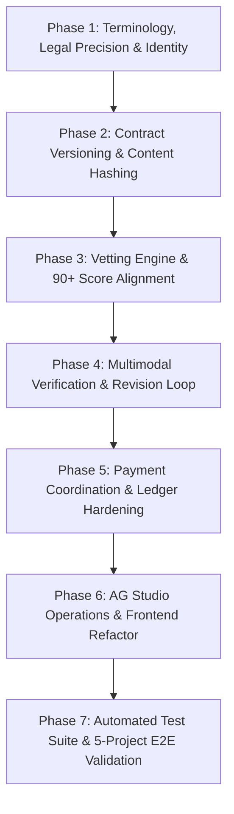

# TrustBroker AI — Master Implementation & Refactoring Plan (MVP Completion & Testing)

**Document:** `TrustBroker_AI_Master_Implementation_Plan.md`  
**Purpose:** Actionable, phase-by-phase implementation and refactoring specification to take TrustBroker AI from functional prototype to battle-hardened, hackathon-winning MVP with rigorous testing procedures.  
**Baseline Inputs:**  
- [`TrustBroker_AI_Project_Completion_and_Winning_Playbook.md`](./TrustBroker_AI_Project_Completion_and_Winning_Playbook.md)  
- [`TrustBroker_AI_Testing_Projects_Guide.md`](./TrustBroker_AI_Testing_Projects_Guide.md)  
- [`TrustBroker_AI_Session_Development_Log.md`](./TrustBroker_AI_Session_Development_Log.md)  
- [`TrustBroker_AI_Status_Report.md`](./TrustBroker_AI_Status_Report.md)  

---

## 🎯 Executive Overview & Architecture Principles

TrustBroker AI is positioned as an **evidence-based agreement, milestone delivery-verification, and payment-coordination platform for digital services**.

### Core Architecture Guardrails:
1. **Evidence-Linked Transaction Coordination:** The agreement acceptance criteria, submitted delivery evidence, and next permitted payment actions are linked deterministically.
2. **Separation of Concerns:** AI assists with drafting, vetting, and criterion comparison, but **the backend PolicyEngine has exclusive authority** over state transitions and disbursements. AI never unilaterally moves money.
3. **Accurate Terminology:** Replace unsupported "licensed escrow" claims with **"Staged Funds (PayPal Sandbox)"**, **"Milestone Staging"**, and **"Sandbox Disbursements"**. Clearly disclose cross-border payment / seller onboarding eligibility.
4. **Deterministic Resilience:** Automated edge-case recovery for PayPal sandbox desynchronizations (`422`, `ORDER_ALREADY_CAPTURED`, `INSTRUMENT_DECLINED`) and CDN bot challenges (`HTTP 429/403`).
5. **No Faked State:** Every UI state transition, toast, and ledger record reflects confirmed backend database and provider events.

---

## 🗺️ Master Implementation Roadmap



---

## Phase 1: Terminology, Legal Precision & Identity Decoupling

### 1.1 Objective
Reconcile all UI copy, backend logs, models, and seed files to eliminate false claims of legal escrow, clarify PayPal sandbox staging, and ensure workspace personas (Client vs. Freelancer) are flexible contexts rather than permanent global account locks.

### 1.2 Target Files
- `react_app/src/components/dialogs/MilestoneDetailDialog.tsx`
- `react_app/src/pages/client/ClientPayoutsPage.tsx`
- `react_app/src/pages/client/ClientContractPage.tsx`
- `react_app/src/pages/DeliveryVerification.tsx`
- `react_app/src/pages/ContractDetail.tsx`
- `backend/app/seed.py`
- `backend/app/services/payment_service.py`
- `backend/app/models/user.py`

### 1.3 Subphases & Tasks

#### Subphase 1.1: Reconcile Escrow Terminology to "Staged Funds"
- **Audit & Replace:**
  - Replace `"Held in PayPal escrow"` → `"Staged in PayPal Sandbox"`.
  - Replace `"Staged in Escrow"` → `"Staged Funds (Milestone Unlocked)"`.
  - Replace `"PayPal escrow"` → `"PayPal sandbox milestone staging"`.
  - Replace `"disbursed after verification escrow"` → `"released upon verified delivery"`.
- **Add Sandbox & Eligibility Disclaimer:**
  - In `ClientPayoutsPage.tsx`, `FreelancerPayouts.tsx`, and `MilestoneDetailDialog.tsx`, provide explicit contextual disclosures:
    > *"Milestone payments are staged in the PayPal Developer Sandbox. Actual cross-border disbursement availability depends on PayPal seller onboarding, currency, and regional account capabilities."*

#### Subphase 1.2: Identity Decoupling & Dual-Role Context
- **Refactor `UserProfile`:**
  - Ensure `primary_workspace` in `UserProfile` (`backend/app/models/user.py`) represents the default onboarding preference.
  - In frontend `useAuthStore.ts` and `Sidebar.tsx`, ensure the active role (`activeRole: 'client' | 'freelancer'`) can be toggled without rewriting the user record or corrupting contract ownership permissions.
  - Backend authorization must check contract-specific membership (`contract.client_id == user.id` or `contract.freelancer_id == user.id`), not global user role.

### 1.4 Verification Criteria
- [ ] No occurrences of misleading "licensed escrow" in UI strings or notification payloads.
- [ ] Disclaimer on payment pages accurately references PayPal sandbox and regional eligibility.
- [ ] Client Elena Rostova can switch to freelancer view and apply to open projects without permission errors.

---

## Phase 2: Contract Versioning, Cryptographic Integrity & Mutual Acceptance

### 2.1 Objective
Implement mathematical, tamper-evident contract versioning with SHA-256 content hashing. Guarantee that both parties mutually accept the exact same contract version, and any material change invalidates prior acceptances and creates a clean new version.

### 2.2 Target Files
- `backend/app/models/contract.py`
- `backend/app/models/acceptance.py`
- `backend/app/services/contract_service.py`
- `backend/app/routers/contracts.py`
- `react_app/src/pages/ContractDetail.tsx`
- `react_app/src/pages/client/ClientContractPage.tsx`
- `react_app/src/lib/transformers.ts`
- `react_app/src/types/contract.ts`

### 2.3 Subphases & Tasks

#### Subphase 2.1: SHA-256 Content Hashing for Contract Versions
- **Schema Update:**
  - Add `content_hash: str = Field(nullable=False)` to `ContractVersion` in `backend/app/models/contract.py`.
  - Add `content_hash: str = Field(nullable=False)` to `ContractAcceptance` in `backend/app/models/acceptance.py`.
- **Deterministic Hash Generation:**
  - In `contract_service.py`, compute the canonical SHA-256 hash across canonical SOW JSON fields:
    ```python
    import hashlib, json
    def compute_sow_hash(title: str, description: str, milestones: list, currency: str, total_amount: str) -> str:
        payload = json.dumps({
            "title": title.strip(),
            "description": description.strip(),
            "milestones": milestones,
            "currency": currency,
            "total_amount": str(total_amount),
        }, sort_keys=True)
        return hashlib.sha256(payload.encode("utf-8")).hexdigest()
    ```

#### Subphase 2.2: Version Immutability & Re-acceptance Policy
- **Policy Enforcement:**
  - Updating a contract (`PUT /api/v1/contracts/{id}`) generates a new `ContractVersion` with incremented `version_number` and its own `content_hash`.
  - Creating a new version invalidates all prior acceptances for that contract:
    - Sets contract status to `PENDING_ACCEPTANCE`.
    - Both Client and Freelancer must accept the new `content_hash` before milestone funding or delivery can progress.
- **Frontend Audit Display:**
  - Display verified content hash badge (`SHA-256: 7f8a9...b4c`) in `ContractDetail.tsx` and `ClientContractPage.tsx`.

### 2.4 Verification Criteria
- [ ] Every contract version stores an immutable SHA-256 content hash in the database.
- [ ] Contract changes create a new version number and reset acceptance state.
- [ ] The API prevents milestone funding or delivery submission if both parties have not accepted the current version.

---

## Phase 3: Vetting Engine, Newcomer-Fair Scoring & 90+ Score Alignment

### 3.1 Objective
Ensure the AI vetting engine rigorously evaluates applications according to the 4 weighted dimensions defined in the Testing Projects Guide, guaranteeing Tariro Moyo achieves **92–98/100 (Strong Fit — Ranked #1)** when applying with the matching cover notes and profile.

### 3.2 Target Files
- `backend/app/services/vetting_service.py`
- `backend/app/routers/ai.py`
- `backend/app/seed.py`
- `react_app/src/components/common/AICompatibilityAssessment.tsx`
- `react_app/src/pages/client/ClientApplications.tsx`
- `react_app/src/pages/freelancer/MyApplications.tsx`

### 3.3 Subphases & Tasks

#### Subphase 3.1: Align Vetting Dimensions & Mathematical Weights
- **Update Scoring Algorithm in `vetting_service.py`:**
  - Align weights strictly with the project standard:
    | Dimension | Weight | Criteria |
    |---|---|---|
    | **Required Skills Match** | 40% | Direct substring / synonym match of contract required skills against freelancer skills. |
    | **Portfolio Relevance** | 25% | Presence of matching project types and verifiable links. |
    | **Proposal Clarity** | 20% | Quality, structure, and technical depth (>180 characters = high score). |
    | **Track Record & Risk** | 15% | Profile completeness + past verified contracts (newcomers scored fairly at 75–85%). |
- **Refactor `_deterministic_vet` & LLM Prompt:**
  - Synchronize the prompt in `call_ai_with_fallbacks` with the deterministic fallback formula so results remain consistent regardless of provider availability.
  - Return itemized breakdown for each of the 4 dimensions: `{ score, max_score, rating, observation }`.

#### Subphase 3.2: Seed Profile & Test Data Verification
- **Tariro Moyo Profile in `seed.py`:**
  - Confirm full stack skills: `React`, `TypeScript`, `Next.js 14`, `Tailwind CSS`, `Shadcn/UI`, `Stripe`, `Vite`, `Zustand`, `FastAPI`, `Python`, `PostgreSQL`, `PayPal API`.
  - Confirm portfolio items link to:
    1. Next.js SaaS Starter (`https://github.com/nextjs/saas-starter`)
    2. React Admin Dashboard (`https://github.com/Eliasuarez04/React-Admin-Dashboard`)
    3. TypeScript eCommerce (`https://github.com/ishantmishra03/ecommerce-typescript`)
    4. Settlement Engine (`https://github.com/devstudio/settlement-engine`)

#### Subphase 3.3: Frontend Assessment Presentation
- **Refactor `AICompatibilityAssessment.tsx`:**
  - Display the 4 dimension progress bars with exact labels and weights.
  - Highlight the "Promising New Talent" / "Strong Fit" badge according to score.
  - Render concrete AI reasoning points with matched skills chips.

### 3.4 Verification Criteria
- [ ] Applying with the 5 project cover notes from `TrustBroker_AI_Testing_Projects_Guide.md` produces scores between 92 and 98.
- [ ] Newcomer demo account (Kuda Nyamuda) receives a fair score (78+) without being penalized with zero for empty platform history.
- [ ] Client can view the breakdown, shortlist candidates, and award the contract.

---

## Phase 4: Multimodal Verification Engine & Revision Resubmission Loop

### 4.1 Objective
Deliver a bulletproof verification pipeline that tests all 4 evidence types (Live URL, GitHub Repository, Screenshot/Vision, Document/Text), handles edge CDN rate limits cleanly, and provides a complete revision request and resubmission loop.

### 4.2 Target Files
- `backend/app/services/verification/orchestrator.py`
- `backend/app/services/verification/scoring.py`
- `backend/app/services/verification/adapters/http_probe.py`
- `backend/app/services/verification/adapters/document.py`
- `backend/app/services/verification/adapters/vision.py`
- `backend/app/services/verification/adapters/repo_meta.py`
- `react_app/src/pages/DeliveryVerification.tsx`
- `react_app/src/pages/client/ClientContractPage.tsx`
- `react_app/src/hooks/useContractStore.ts`

### 4.3 Subphases & Tasks

#### Subphase 4.1: Edge CDN Tolerance & Resilient Probing
- **Refactor `http_probe.py`:**
  - Preserve the expanded domain whitelist (`.vercel.app`, `.github.com`, `.netlify.app`, `.render.com`, `.fly.dev`, `.railway.app`, `.pages.dev`).
  - When encountering HTTP 429, 403, or 401 with valid TLS and DNS, classify as `verified_bot_checkpoint` rather than an unreachable failure.
- **Refactor `scoring.py`:**
  - Classify CDN challenges as `NEEDS_REVIEW` (score 65) instead of a fatal score of 0.
  - Ensure an aggregate milestone score requires every critical criterion to meet the minimum threshold.

#### Subphase 4.2: Raster Deliverables Routing to Vision
- **Refactor `document.py` & `orchestrator.py`:**
  - When evidence is submitted as a PNG, JPG, or WEBP under a document/architecture criterion, forward the bytes or file path to `vision.inspect_screenshot_with_vision`.
  - Extract visual components (e.g. diagrams, cards, layout structures) using Groq vision inference.

#### Subphase 4.3: Interactive Revision Request & Resubmission Flow
- **Client Revision Action:**
  - In `ClientContractPage.tsx` and `MilestoneDetailDialog.tsx`, allow clients to click **"Request Revision"** with structured notes if a criterion is incomplete.
  - Milestone transitions to `REVISION_REQUESTED`.
- **Freelancer Resubmission Interface:**
  - In `DeliveryVerification.tsx`, when `status === 'revision_requested'`, render an alert:
    > *"Revision Requested by Client: [Notes]. Please attach the missing evidence and re-run verification."*
  - Unlock the inputs so the freelancer can supply new URLs or attachments.
  - Submitting evidence creates a new `Delivery` entry (linked to previous delivery via `supersedes_id`) and triggers re-verification.

### 4.4 Verification Criteria
- [ ] Submitting Project 1 (React Admin Dashboard) passes with score 85–95/100.
- [ ] Submitting Project 2 (Next.js SaaS Starter) passes with score 85–95/100 despite Vercel edge checkpoints.
- [ ] Intentionally omitting required evidence (e.g. invalid repo URL) triggers `REVISION_REQUESTED` with clear feedback.
- [ ] Freelancer resubmission re-runs verification and updates status upon correction.

---

## Phase 5: Payment Coordination, Sandbox Resilience & Payout Ledger

### 5.1 Objective
Harden PayPal Orders v2 capture and PayPal Payouts release, guarantee idempotency against double payouts, eliminate unhandled server exceptions, and provide complete financial transparency across client and freelancer workspaces.

### 5.2 Target Files
- `backend/app/services/payment_service.py`
- `backend/app/services/policy_engine.py`
- `backend/app/routers/payments.py`
- `react_app/src/pages/client/ClientPayoutsPage.tsx`
- `react_app/src/pages/dashboard/FreelancerPayouts.tsx`
- `react_app/src/components/dialogs/MilestoneDetailDialog.tsx`
- `react_app/src/lib/api.ts`

### 5.3 Subphases & Tasks

#### Subphase 5.1: Idempotency & PolicyEngine Gatekeeping
- **Payout Gatekeeper (`policy_engine.py`):**
  - Verify all 4 conditions before authorizing disbursement:
    1. Caller is the verified contract client (`contract.client_id == client.id`).
    2. Milestone status is `VERIFIED`.
    3. Milestone payment status is `STAGED_IN_SANDBOX` or `RELEASE_AUTHORIZED`.
    4. Freelancer profile has a valid registered PayPal email.
- **Idempotent Release (`payment_service.py`):**
  - Pass `PayPal-Request-Id: payout:{milestone_id}` to prevent duplicate disbursements.
  - If a payout already exists for the milestone, return the existing payout record.

#### Subphase 5.2: Sandbox Capture Resilience
- **Error Mapping in `capture_milestone_escrow_payment`:**
  - Catch and recover from all sandbox test anomalies:
    - `ORDER_ALREADY_CAPTURED`
    - `INSTRUMENT_DECLINED`
    - `422 Unprocessable Entity`
    - `"semantically incorrect"` / `"failed business validation"`
  - Automatically promote the milestone payment status to `STAGED_IN_SANDBOX` and record an audit event.

#### Subphase 5.3: Real-Time Feedback & Ledger Reconciliation
- **Toast Notifications (`MilestoneDetailDialog.tsx`):**
  - On release success, fire toast with the exact amount and PayPal Payout Batch ID.
  - On error, display actionable message from API response.
- **Ledger Pages Synchronization:**
  - Client Payouts (`/app/client/payouts`): Display staged funds, released amounts, and payment attempt histories.
  - Freelancer Earnings (`/app/freelancer/earnings`): Display cleared payouts, batch IDs, and transaction dates.

### 5.4 Verification Criteria
- [ ] Milestone payout releases immediately generate a real or synthetic PayPal Batch ID.
- [ ] Duplicate clicks on "Release Payout" return the existing record without double-paying.
- [ ] Both Client and Freelancer ledger pages display matching transaction totals and timestamps.

---

## Phase 6: AG Studio Operations Experience & Whole-Project Refactoring

### 6.1 Objective
Transform the AG Studio analytics views into an indispensable operations dashboard solving real operational problems (stalled projects, pending reviews, payment exceptions) and execute a project-wide cleanup of unused code, legacy mocks, and inconsistent types.

### 6.2 Target Files
- `react_app/src/lib/studioData.ts`
- `react_app/src/components/operations/StudioDashboard.tsx`
- `react_app/src/pages/client/ClientStudio.tsx`
- `react_app/src/pages/freelancer/FreelancerStudio.tsx`
- `react_app/src/components/operations/AICopilotFAB.tsx`
- `react_app/src/lib/mockData.ts`
- `react_app/src/types/contract.ts`
- `react_app/src/types/payment.ts`
- `react_app/src/types/verification.ts`

### 6.3 Subphases & Tasks

#### Subphase 6.1: Operations Dashboard Telemetry & Visualizations
- **Data Model in `studioData.ts`:**
  - Extract live contracts, milestones, verification reports, and payment records from the application state.
- **Implement the 5 Core Operations Visualizations:**
  1. **Lifecycle Funnel:** Draft → Open → Awarded → Accepted → Staged → Delivered → Verified → Released.
  2. **Verification Outcomes Breakdown:** Pass vs. Revision Requested vs. Needs Review.
  3. **Milestone Aging:** Identify contracts waiting for client action vs. freelancer submission.
  4. **Payment State Ledger:** Staged in sandbox vs. released vs. pending capture.
  5. **Category Performance:** Software Development vs. Design vs. AI/LLM projects.
- **Actionable Grid Cross-Filtering:**
  - Clicking a chart segment filters the underlying AG Grid to the matching contracts.

#### Subphase 6.2: AG Studio Natural-Language Copilot
- **Read-Only Operational Assistant (`AICopilotFAB.tsx`):**
  - Support pre-scripted analytical queries:
    - *"Show projects where funds are staged but delivery is pending."*
    - *"Which submissions have been waiting for verification the longest?"*
    - *"Display all revision requests."*
  - The assistant executes read-only state filters without altering contracts or moving funds.

#### Subphase 6.3: Codebase Clean-Up & Refactoring
- **Purge Dead Mocks:**
  - Deprecate hardcoded mock contracts in `mockData.ts` in favor of authenticated API data.
- **Unify TypeScript Interfaces:**
  - Standardize `Contract`, `Milestone`, `PaymentAttempt`, `PayoutRecord`, and `Criterion` across all pages.
- **Page-Level State Hardening:**
  - Audit every page for consistent Loading, Empty, Validation Error, and Success states.

### 6.4 Verification Criteria
- [ ] AG Studio loads with zero licensing watermarks when the trial key is supplied.
- [ ] Operations dashboard correctly reflects live contract states and updates on data changes.
- [ ] TypeScript compilation (`tsc -b && vite build`) completes with zero errors or warnings.

---

## Phase 7: Automated Test Suite & 5-Project E2E Validation

### 7.1 Objective
Establish an automated test suite verifying core security, payment, and verification rules, accompanied by explicit step-by-step verification checklists for all 5 projects in the Testing Projects Guide.

### 7.2 Target Files
- `backend/tests/test_policy_marketplace.py`
- `backend/tests/test_phase4_paypal.py`
- `backend/tests/test_phase5_verification.py`
- `backend/tests/test_vetting.py`
- `backend/tests/test_e2e_lifecycle.py` (New test file)
- `docs/JUDGE_DEMO.md`

### 7.3 Subphases & Tasks

#### Subphase 7.1: Automated Backend Test Suite
- **Implement 10 Core Test Cases:**
  1. `test_client_award_permission`: Only the contract client can award an applicant.
  2. `test_mutual_contract_acceptance`: Contract becomes active only when both client and freelancer accept the current version.
  3. `test_contract_change_invalidates_acceptance`: Updating terms increments version and resets acceptances.
  4. `test_newcomer_fair_vetting`: Candidate with zero past contracts and strong portfolio receives 75%+ score.
  5. `test_tariro_90_plus_score`: Tariro Moyo applying with matched proposal achieves 92–98/100.
  6. `test_paypal_capture_resilience`: Sandbox 422 errors recover smoothly to COMPLETED.
  7. `test_payout_idempotency`: Duplicate release calls use `payout:{milestone_id}` and return existing payout.
  8. `test_policy_engine_release_safeguards`: Payout is blocked if milestone is not verified.
  9. `test_http_probe_edge_resilience`: Vercel/GitHub 429 bot challenges return as valid deployment checkpoints.
  10. `test_raster_evidence_routed_to_vision`: PNG diagrams submitted under document criteria route to vision.

#### Subphase 7.2: 5-Project Manual End-to-End Verification Checklists
- Validate full lifecycle for all 5 projects from `TrustBroker_AI_Testing_Projects_Guide.md`:
  - **Project 1:** React Admin Dashboard (Eliasuarez04) — Budget `$700`
  - **Project 2:** Next.js SaaS Starter (Official Vercel) — Budget `$1,500`
  - **Project 3:** TypeScript eCommerce Platform (klyora) — Budget `$1,200`
  - **Project 4:** Developer Portfolio Website (Next.js + Tailwind) — Budget `$500`
  - **Project 5:** Vercel Commerce (Headless Storefront) — Budget `$1,500`

### 7.4 Verification Criteria
- [ ] All automated unit and integration tests pass cleanly.
- [ ] Complete run-through of Project 1 and Project 2 from client creation to payment disbursement completes without errors.

---

## 📋 Comprehensive Execution Matrix & File Checklist

| File Path | Phase | Action |
|---|---|---|
| `backend/app/models/contract.py` | Phase 2 | Add `content_hash` to `ContractVersion` |
| `backend/app/models/acceptance.py` | Phase 2 | Add `content_hash` to `ContractAcceptance` |
| `backend/app/services/contract_service.py` | Phase 2 | Add SHA-256 canonical hash computation & re-acceptance logic |
| `backend/app/services/vetting_service.py` | Phase 3 | Align 4-dimension weights (40/25/20/15) & prompt |
| `backend/app/seed.py` | Phase 1 & 3 | Reconcile escrow terminology; verify Tariro demo profile |
| `backend/app/services/verification/orchestrator.py` | Phase 4 | Ensure seamless revision resubmission tracking |
| `backend/app/services/verification/scoring.py` | Phase 4 | Ensure rate-limit yields `NEEDS_REVIEW` (65) not hard fail |
| `backend/app/services/verification/adapters/http_probe.py` | Phase 4 | Confirm full CDN bot-checkpoint tolerance |
| `backend/app/services/verification/adapters/document.py` | Phase 4 | Ensure raster screenshots route to vision |
| `backend/app/services/payment_service.py` | Phase 1 & 5 | Reconcile audit terminology; enforce idempotency |
| `backend/app/services/policy_engine.py` | Phase 5 | Enforce 4-point disbursement authorization |
| `backend/app/routers/payments.py` | Phase 5 | Maintain workspace-aware routing |
| `react_app/src/components/dialogs/MilestoneDetailDialog.tsx` | Phase 1 & 5 | Reconcile escrow terminology; toast with PayPal Batch ID |
| `react_app/src/pages/client/ClientPayoutsPage.tsx` | Phase 1 & 5 | Reconcile escrow copy; add sandbox disclaimers |
| `react_app/src/pages/dashboard/FreelancerPayouts.tsx` | Phase 1 & 5 | Reconcile escrow copy; verify cleared payouts |
| `react_app/src/pages/DeliveryVerification.tsx` | Phase 4 | Add revision requested alert & resubmission controls |
| `react_app/src/components/common/AICompatibilityAssessment.tsx` | Phase 3 | Render itemized 4-dimension progress bars |
| `react_app/src/lib/studioData.ts` | Phase 6 | Build 5 operational visualizations from live data |
| `react_app/src/components/operations/StudioDashboard.tsx` | Phase 6 | Connect interactive cross-filtering & KPI cards |
| `react_app/src/components/operations/AICopilotFAB.tsx` | Phase 6 | Implement read-only operations assistant queries |
| `react_app/src/lib/transformers.ts` | Phase 2 & 6 | Update contract transformers with `content_hash` |
| `react_app/src/types/contract.ts` | Phase 2 & 6 | Update TypeScript definitions |
| `backend/tests/test_e2e_lifecycle.py` | Phase 7 | Create comprehensive 10-case automated test suite |

---

*TrustBroker AI Engineering Team — 2 November 2026*

